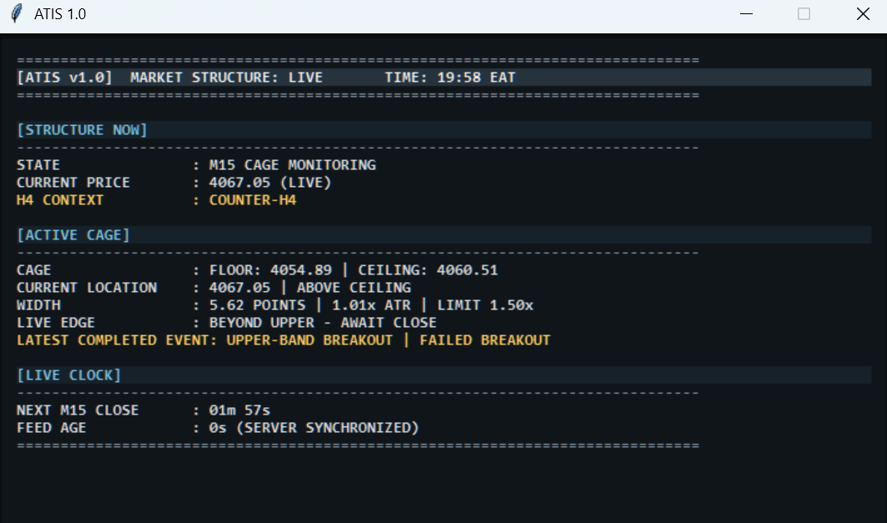

# ATIS — engineering showcase

**A local market-structure observation interface by Ian Wahome Mbugua.**

ATIS brings market context, completed-bar events, data freshness and observation
history into a compact desktop HUD. It is a functional local demonstration, not
yet deployed for live business use. The complete application is maintained privately.

## Problem

A changing price display can blur the distinction between a forming candle and a
confirmed event. ATIS makes that distinction visible and keeps prior observations
available for review.

## Approach

- Separate completed H4/M15 inputs from live display telemetry.
- Keep validated boundaries stable through the relevant observation lifecycle.
- Display market context, event state, feed age and bar timing together.
- Preserve completed-bar observations separately from operator-entered journal notes.
- Verify deterministic behavior with synthetic fixtures and local database tests.

The project demonstrates workflow design, state management, information hierarchy,
Python development, local persistence and regression testing. It is a manual
observation tool; it does not execute trades or demonstrate predictive performance.

## Demonstration

Read the [two-minute walkthrough](docs/WALKTHROUGH.md),
[case study](docs/CASE_STUDY.md), and [conceptual architecture](docs/ARCHITECTURE.md).
The two screenshots were found in the existing portfolio assets and visually
reviewed before publication. They show historical interface states, not a new
live-session verification or proof that every displayed field matches this baseline.
No account identifier, balance or personal contact detail is visible in them.

## Evidence

**20 October 2026: 45 offline strategy and reporting tests passed.**
These tests ran against the private baseline and are not included in this public
repository. See [validation and limitations](docs/VALIDATION.md).
The inspected requirements document identifies version 5.8, although its original
development directory retains the older `v5_3` name.

## Limitations and publication boundary

This repository contains documentation and reviewed interface screenshots only.
The engine, detailed rule specification, full tests, launcher, local databases,
journal records and configuration remain private. It is not a runnable application.
No live terminal session, real email delivery, profitability, broker approval,
autonomous AI feature or production deployment is established by these materials.

Copyright (c) 2026 Ian Wahome Mbugua. All rights reserved. See [LICENSE](LICENSE).
Public visibility permits inspection and remains subject to GitHub's terms;
copyright restrictions do not technically prevent copying.
