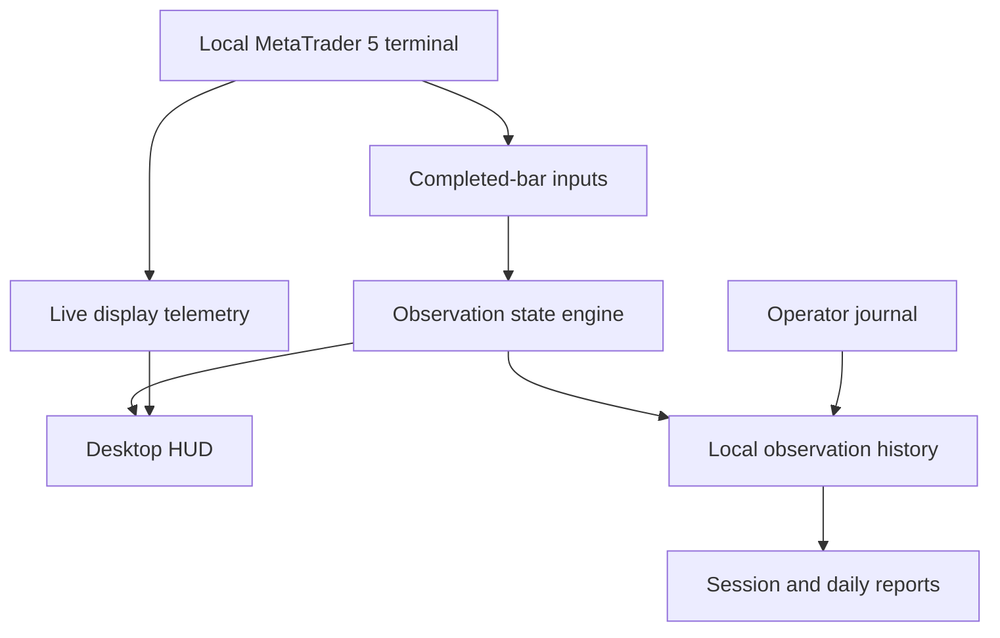

# Conceptual architecture

Python and Tkinter provide the local interface; SQLite stores reporting records.
H4 supplies context and M15 supplies observation structure. Live display values
remain distinguishable from completed-bar classifications. Operator journal input
does not become a measured software observation. Email is an optional, separately
configured delivery path and is not exercised by the offline verification.

This diagram intentionally omits proprietary rules and implementation details.
