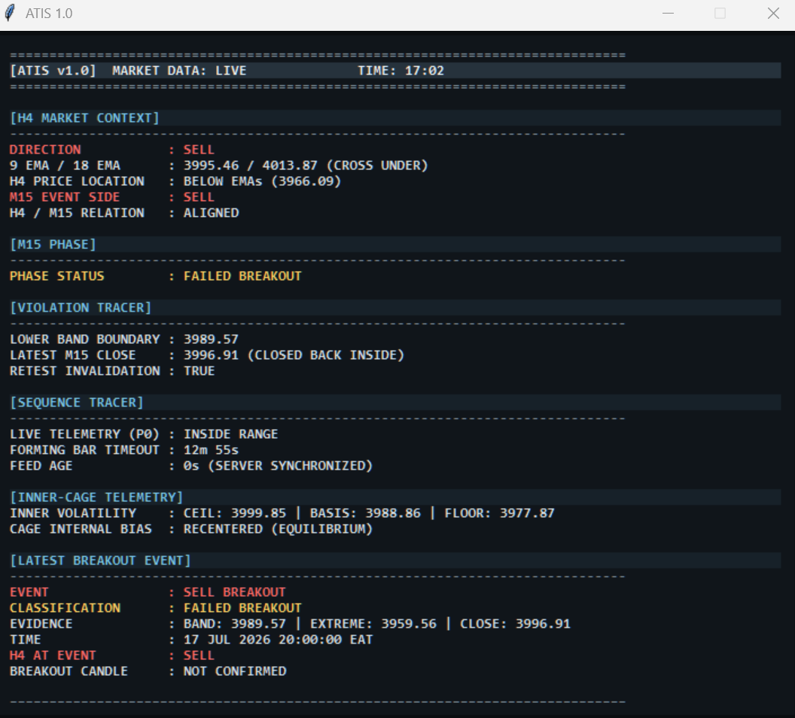

# Two-minute reviewer walkthrough

1. Open the README screenshot. Inspect the structure state, active boundaries,
   current location, event label and feed timing as an information-design example.
2. View the context screenshot below. Compare H4 context, M15 phase, completed
   event information and live telemetry. Directional labels describe the historical
   interface state; they are not current recommendations.
3. Read the conceptual architecture and validation note to distinguish what the
   software implements, what tests verified, and what remains unverified.

These existing portfolio images are historical captures. Their exact capture time
and fixture provenance were not independently established during this upload.
The public repository cannot connect to a broker, start the HUD or run the private tests.
